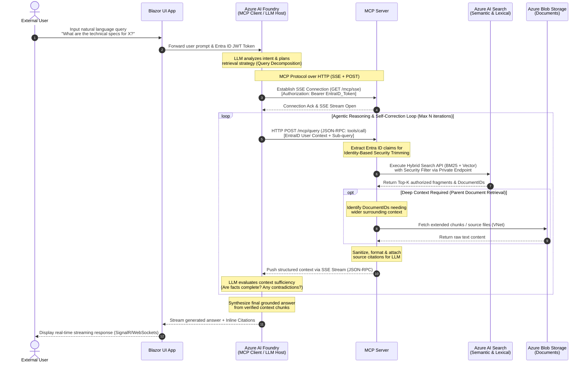

# Agentic RAG Data Flow: Content Discovery & Deep Contextual Search

This section describes the end-to-end data flow when an external user queries the system using natural language to discover or analyze document contents. 
The process leverages an **Agentic Retrieval-Augmented Generation (RAG)** pattern orchestrated via the open-source **Model Context Protocol (MCP)** standard.

### Detailed Data Flow Steps:

1. **Query Ingestion & Contextual Enrichment:**
The **Blazor UI** captures a user's natural language question (e.g., *"What are the specific technical requirements for X?"*) through the browser and forwards it to **Azure AI Foundry**, passing the **Microsoft Entra ID JWT token** for identity preservation.

2. **Cognitive Intent Analysis & Tool Discovery (Reasoning):**
Acting as the **MCP Host**, **Azure AI Foundry** evaluates intent, performs **Query Decomposition**, and invokes the **MCP Client** over an SSE/HTTP connection using a **JSON-RPC** `tools/call` payload with the user's identity via an `Authorization: Bearer` header.

3. **Hybrid Search Execution with Security Trimming (Retrieval - Phase 1):** 
    **MCP Server #1 (AI Search Tool)** applies security trimming using user claims from the token and executes a **Hybrid Search** combining BM25 and semantic vector search in **Azure AI Search**.

4. **Conditional Deep Context Extraction (Retrieval - Phase 2):**
   **Azure AI Search** processes the filtered query and returns only the top-K relevant document fragments, metadata, and unique identifiers (`DocumentIDs`) that the user is explicitly authorized to see. If the AI Agent's cognitive logic requires deeper textual analysis, cross-referencing, or full-file validation, **MCP Server #1** securely connects to **Azure Blob Storage** via internal virtual networking to pull the raw source text files or extended chunks matching those verified IDs.

5. **Context Aggregation & Response Generation (Anti-Hallucination Guardrails):** 
   **MCP Server #1** sanitizes and structures the retrieved text fragments and metadata, converting them into a clean, text-rich payload specifically optimized for LLM prompting, complete with auto-generated source file citations. This structured context is transmitted back to the **MCP Client** over the open SSE stream. The LLM synthesizes the user's original query with these newly fetched, verified facts, generating a highly accurate, context-aware, and hallucination-free response. By strictly bounding the model's generation to this verified payload, the architecture enforces **deterministic grounding** and guarantees full auditability required for mission-critical enterprise engineering documentation.

8. **Real-Time Streaming Delivery (Operations):** 
   The generated natural language response, along with its precise inline citations (e.g., `[Source: Schema_Krakow_2026.pdf]`), is streamed back incrementally to minimize perceived latency. The backend immediately pushes this data stream to the **Blazor UI** in real time via **Azure SignalR Service** over WebSockets, rendering the text smoothly on the user's screen as it is being synthesized.
