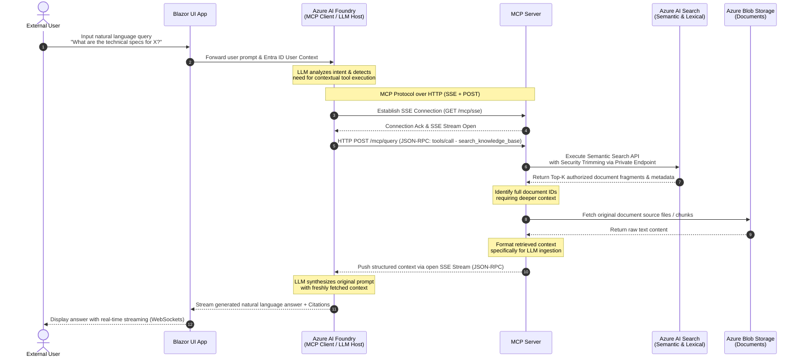

# Agentic RAG Data Flow: Content Discovery & Deep Contextual Search

This section describes the end-to-end data flow when an external user queries the system using natural language to discover or analyze document contents. 
The process leverages an **Agentic Retrieval-Augmented Generation (RAG)** pattern orchestrated via the open-source **Model Context Protocol (MCP)** standard.

### Detailed Data Flow Steps:

1. **Query Ingestion & Contextual Enrichment:** 
   An external user submits a natural language question (e.g., *"What are the specific technical requirements for X?"*) through the browser. The **Blazor UI** captures the input and forwards it to the orchestration layer embedded within **Azure AI Foundry**, passing the user's secure **Microsoft Entra ID JWT token** along with the prompt to ensure absolute data isolation and context preservation.

2. **Cognitive Intent Analysis & Tool Discovery (Reasoning):** 
   The request is received by **Azure AI Foundry** (acting as the core **MCP Host**). The Large Language Model (LLM) evaluates the user's intent, recognizes that answering the query requires external system knowledge, and dynamically selects the optimal capability from its runtime-discovered tool catalog. The internal **MCP Client** then formats a structured, compliant `tools/call` request encapsulated in a **JSON-RPC** payload.

3. **Hybrid Search Execution with Security Trimming (Retrieval - Phase 1):** 
   The MCP Client transmits the tool invocation request over a secure transport layer (SSE/HTTP) to **MCP Server #1 (AI Search Tool)**. This microservice acts as an architectural abstraction barrier. It extracts the user's claims from the Entra ID context to apply strict **Security Trimming (Identity-based pre-filtering)**, and executes a high-performance **Hybrid Search** query against **Azure AI Search** over a secure **Private Endpoint**. The execution engine combines:
   * *Lexical Search (BM25)* for precise technical keyword matching (e.g., "Kraków", "schema").
   * *Semantic Search* leveraging vector embeddings to capture the conceptual meaning and intent behind the user's natural language phrasing.

4. **Document Content Extraction (Retrieval - Phase 2):** 
   **Azure AI Search** processes the filtered query and returns only the top-K relevant document fragments, metadata, and unique identifiers (`DocumentIDs`) that the user is explicitly authorized to see. If the AI Agent's cognitive logic requires deeper textual analysis, cross-referencing, or full-file validation, **MCP Server #1** securely connects to **Azure Blob Storage** via internal virtual networking to pull the raw source text files or extended chunks matching those verified IDs.

5. **Context Aggregation & Response Generation (Anti-Hallucination Guardrails):** 
   **MCP Server #1** sanitizes and structures the retrieved text fragments and metadata, converting them into a clean, text-rich payload specifically optimized for LLM prompting, complete with auto-generated source file citations. This structured context is transmitted back to the **MCP Client** over the open SSE stream. The LLM synthesizes the user's original query with these newly fetched, verified facts, generating a highly accurate, context-aware, and hallucination-free response. By strictly bounding the model's generation to this verified payload, the architecture enforces **deterministic grounding** and guarantees full auditability required for mission-critical enterprise engineering documentation.

6. **Real-Time Streaming Delivery (Operations):** 
   The generated natural language response, along with its precise inline citations (e.g., `[Source: Schema_Krakow_2026.pdf]`), is streamed back incrementally to minimize perceived latency. The backend immediately pushes this data stream to the **Blazor UI** in real time via **Azure SignalR Service** over WebSockets, rendering the text smoothly on the user's screen as it is being synthesized.
