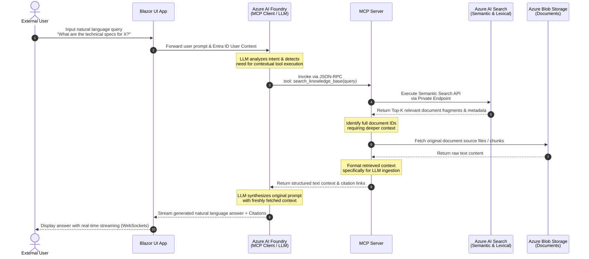
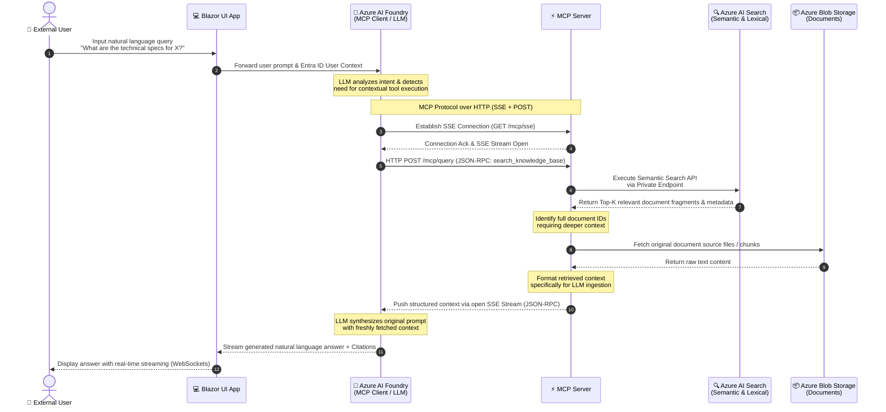

# Agentic RAG Data Flow: Content Discovery & Deep Contextual Search

This section describes the end-to-end data flow when an external user queries the system using natural language to discover or analyze document contents. The process leverages an **Agentic Retrieval-Augmented Generation (RAG)** pattern orchestrated via the **Model Context Protocol (MCP)**.

### Detailed Data Flow Steps:

1. **Query Ingestion & Contextual Enrichment:** 

   An external user submits a natural language question (e.g., *"What are the specific technical requirements for X?"*) through the browser.
   The **Blazor UI** captures the input and forwards it to the orchestration   layer along with the user's secure **Microsoft Entra ID JWT token** to ensure data isolation.

2. **Cognitive Intent Analysis (Reasoning):** 

   The request is received by **Azure AI Foundry**, where the AI Agent framework (acting as an **MCP Host**) submits the prompt to the Large Language Model (LLM).
   The LLM evaluates the prompt, determines that it requires external knowledge to answer, and dynamically decides to call the required capability.
   It formats a structured **JSON-RPC** tool invocation request via the **MCP Client**.

3. **Hybrid Search Execution (Retrieval - Phase 1):** 

   The MCP Client transmits the tool request over a secure transport protocol (SSE/HTTP) to **MCP Server #1 (AI Search Tool)**.
   This dedicated microservice acts as an abstraction barrier and executes a **Hybrid Search** query against **Azure AI Search** over a secure **Private Endpoint**. The search engine combines:
   * *Lexical Search (BM25)* for precise keyword matching (e.g., "Kraków", "transformer").
   * *Semantic Search* to capture the conceptual meaning and intent behind the user's wording.

5. **Document Content Extraction (Retrieval - Phase 2):** 

   **Azure AI Search** returns the top relevant document chunks, metadata, and unique identifiers (`DocumentIDs`).
   If deeper textual analysis or full-file validation is required by the agent's logic, **MCP Server #1** reaches out directly to **Azure Blob Storage** via internal networking
   to pull the raw source text files matching those IDs.

7. **Context Aggregation & Response Generation:** 

   **MCP Server #1** sanitizes and structured the retrieved data, converting it into a clean, text-rich payload optimized for LLM ingestion, complete with source file citations.
   This structured context is passed back to the **MCP Client**. The LLM synthesizes the user's original question with the verified facts, generating a highly accurate, hallucination-free response.

9. **Real-Time Streaming Delivery:** 

   The generated answer, including inline citations (e.g., `[Source: Schema_Krakow_2026.pdf]`), is streamed back to the backend and pushed to the **Blazor UI** in real time via **Azure SignalR Service** (WebSockets).     This allows the answer to render incrementally on the user's screen, minimizing perceived latency.
