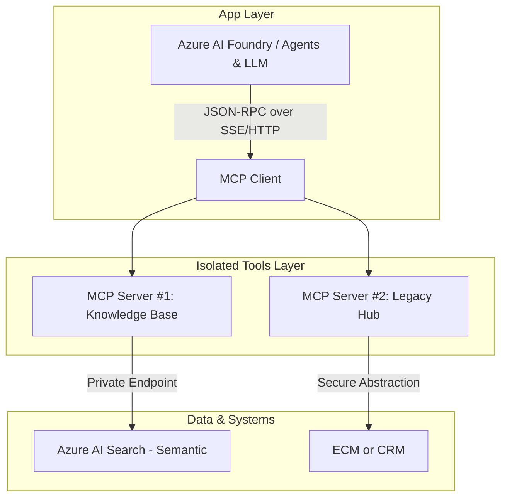

# Cloud-native System to mange documents with AI content search
Application with RAG and AI Agents

# 1. Solution Architecture Overview
This is a **cloud-native document discovery and management system built entirely on Microsoft Azure**. The primary purpose of the system is to aggregate, search, and manage documents stored across enterprise content management systems (such as OpenText and various CRM platforms). Additionally, the platform enables secure external sharing of specific documentation, such as technical schemas and diagrams, with third-party users and external user groups.

# 2. Core Architecture Components

## Infrastructure & Storage Layer
- **Identity & Access Management:**  **Microsoft Entra ID** serves as the system's core identity provider, managing secure authentication, Single Sign-On (SSO), Multi-Factor Authentication (MFA), and role-based access control (RBAC) for both internal and external users.
- **Storage Layer:**  **Azure Blob Storage** is utilized for highly scalable and secure storage of the synchronized document files.
- **Data Layer:**  **Azure SQL Database** functions as the structured data store, holding document metadata, operational logs, and system states.
- **Search & AI Engine:**  **Azure AI Search** provides advanced indexing capabilities, enhanced with Semantic Search to deliver highly relevant, context-aware search results.

## Application & Logic Layer
- **Frontend & Backend Hosting:**  Azure App Services hosts the application layer, which consists of a **Blazor UI** web application for the user interface and an **ASP.NET Core 10 Web API** for the backend business logic.
- **Asynchronous & Long-Running Operations:** Long-running processes are decoupled using Azure Functions.
- **State Machine & Orchestration:** Complex, high-volume file operations (such as bulk copying or data purging) are orchestrated via Azure Durable Functions acting as a state machine. This setup utilizes a combination of Orchestrator Functions, Activity Functions, HTTP-triggered Functions, and various other system triggers.

## Intelligent AI Layer

- **AI Agents Integration:** The architecture includes an advanced AI layer powered by Azure AI Foundry. This layer leverages autonomous AI Agents and Large Language Models (LLMs) to interact with the indexed data, enabling semantic content discovery and answering natural language queries for the end users.

# 3. Event-Driven Synchronization & Real-Time UI
To keep the system highly responsive and decoupled from corporate legacy systems, the architecture utilizes an **event-driven design for real-time document synchronization:**
- **Event Ingestion (Azure Service Bus):** When an internal user creates, modifies, or deletes a document directly inside **OpenText** or the **CRM**, these platforms publish a lightweight event to **Azure Service Bus**.
- **Payload Metadata:** The event payload contains essential document metadata (such as *Author*, *Title*, *Version*, and *Unique Identifier*), which is sufficient for basic querying and indexing.
- **Real-Time UI Updates (SignalR & WebSockets):** An Azure Function processes these Service Bus messages and immediately pushes a broadcast notification to the frontend via Azure SignalR Service. Using native WebSockets, the Blazor UI dynamically reflects the new or updated document on the user's screen in real time, without requiring a manual page refresh.

# 4. Resilience & Security Defense Mechanisms (Service Bus & SignalR)

To guarantee enterprise-grade security and fault tolerance within the event-driven synchronization layer, the architecture implements the following defense mechanisms:

## Real-Time Security & Multi-Tenant Isolation (SignalR + Entra ID)

- **Token-Based Connection:** When the Blazor UI establishes a WebSocket connection with the Azure SignalR Service, it passes the user's Microsoft Entra ID JWT token. SignalR authenticates the user and maps their connection to specific security groups.
- **Granular Group Scoping:** Documents are never broadcasted globally. Instead, SignalR messages are published to scoped SignalR Groups that mirror the access control lists (ACLs) or tenant IDs of the documents.
- **Double-Check Validation:** Even if a real-time notification reaches the UI, the frontend component verifies the user's local permissions via Entra ID claims before rendering the document metadata, ensuring external users never catch a glimpse of unauthorized metadata.

## Fault Tolerance & Guaranteed Delivery (Service Bus Resilience)

- **At-Least-Once Delivery & Peek-Lock:** Azure Functions process messages from Azure Service Bus using the Peek-Lock pattern. A message is only deleted from the queue after the metadata is successfully processed and the SignalR broadcast is initiated.
- **Dead-Letter Queue (DLQ) Strategy:** If a message from OpenText or CRM fails to process due to a transient error, the built-in retry policy triggers. If it fails consecutively (e.g., 5 times due to a database timeout), Service Bus automatically moves it to the **Dead-Letter Queue (DLQ)**.
- **DLQ Alerting & Remediation:** A secondary, automated Azure Function monitors the DLQ, raising critical alerts in **Azure Monitor / Application Insights** for the operations team, ensuring zero data loss and easy reprocessing once the underlying system recovers.

## Idempotency & De-duplication

- **Message De-duplication:** Legacy systems (like OpenText) can occasionally retry sending the same webhook event. Azure Service Bus is configured with a de-duplication window using the document's unique EventID or DocumentID + Version.
- **Idempotent Consumers:** The processing Azure Functions check the version number in the **Azure SQL Database** before executing. If an older or duplicate event arrives out of order, the system safely ignores it, preventing race conditions and UI flickering.

# 5. Model Context Protocol (MCP) Integration

- To enable dynamic, agentic document discovery, the architecture implements the open-source **Model Context Protocol (MCP)** standard. This decouples the Large Language Model (LLM) from data sources and encapsulates system capabilities into reusable, secure tools.

The MCP ecosystem within this architecture is divided into three layers:
- **Azure AI Foundry**(Agents / LLM) -> **MCP Client** (JSON-RPC) -> **MCP Server #1** -> **Azure AI Search** (Semantic) 
- **Azure AI Foundry**(Agents / LLM) -> **MCP Client** (JSON-RPC) -> **MCP Server #2** -> **ECM or CRM**  

----------------

----------------

## MCP Client (Orchestration & Application Layer)
- **Location:** Embedded within the **Application Layer**, natively running inside **Azure AI Foundry (Agents/LLM)**.
- **Implementation:** Modern agentic frameworks (such as *Semantic Kernel* or *LangChain*) hosted in Azure AI Foundry act as the native MCP Host, where the MCP Client resides. Alternatively, for custom .NET/Python orchestration, the client is implemented directly within the **App Service Web API**.
- **Communication:** The MCP Client communicates with MCP Servers using lightweight, asynchronous **JSON-RPC** queries over secure **SSE (Server-Sent Events) / HTTP** transport protocols.

## MCP Server #1 (Knowledge Base – Azure AI Search)
- **Location:** Deployed as a dedicated, isolated microservice using **Azure Container Apps** or **Azure Functions (Flex Consumption)** within Region 1, adjacent to Azure AI Search.
- **Role:** Acts as a specialized tool for the LLM. When the model requests semantic context, the MCP Server queries the Azure AI Search index via a secure **Private Endpoint** and returns clean, structured text context back to the client.

## MCP Server #2 (Legacy & External Systems – OpenText / CRM)
- **Location:** Positioned on the boundary of Region 1, interfacing directly with the **External Systems (OpenText ECM / CRM)**.
- **Role:** Functions as a secure abstraction layer. Instead of exposing full API keys or a direct connection string to the CRM/OpenText, this server exposes strictly defined tools (e.g., get_latest_document_status(id)) to the LLM, isolating the core AI engine from legacy system complexities.

# Architectural Justification & Security Benefits

## Principle of Least Privilege:
  The LLM never holds direct database connection strings or broad API access to SQL or OpenText. It interacts exclusively with granular, structured tools explicitly exposed and strictly validated by the MCP Servers.
## Network Isolation (Security Boundary):
  MCP Servers reside within dedicated, private subnets (MCP subnets). All communication with core Azure data repositories and external systems is strictly funneled through secure Private Endpoints.
## Seamless Scalability:
  Integrating a new corporate data source (e.g., an issue-tracking system) requires zero code modifications to the App Service or Azure AI Foundry  orchestration. A new, independent MCP Server is simply deployed, and the MCP Client dynamically discovers its capabilities.
 
  
# Architectural Decision: Traditional API vs. MCP

The core rule governing this architecture is simple: Traditional APIs are utilized when the developer explicitly dictates the execution path; the MCP standard is utilized when the LLM Agent must dynamically choose the optimal tool to solve a complex problem.

| Feature	| Traditional API (REST / GraphQL)	| Model Context Protocol (MCP) Standard |
|--| --|--|
| **Decision Maker**	| **Developer** (Application code rigidly invokes a hardcoded GET /documents endpoint).	| **LLM / AI Agent** (Dynamically selects the best tool from a runtime-discovered catalog).|
| **Data Format** |	Returns raw **JSON/XML**, requiring manual parsing and explicit mapping in code.	| Returns **LLM-optimized context** (Text, clean metadata, and errors formatted for prompting).
| **Integration Cost** | Requires unique, custom **integration glue-code** for every newly connected system.	| True **Plug & Play** architecture; servers advertise their capabilities using a universal schema.|
| **Primary Use Case** | Deterministic business logic, user interfaces, mass data syncs (**ETL Pipelines**).	 | **RAG systems, autonomous AI agents**, and multi-step cognitive reasoning tasks.|

# Where Traditional API is Maintained:
Maintained where the business process is strictly linear, highly repeatable, and requires zero cognitive reasoning:
- **UI-to-Backend Communication:** When a user clicks "Download PDF" in the Blazor UI, the application fires a standard REST API call to fetch the blob. No AI reasoning is required.
- **ETL Operations (Durable Functions):** Bulk copying, state machine orchestration, and system-wide metadata extraction are automated via robust, deterministic SDKs and standard APIs.

# Where MCP is Introduced:
Introduced exclusively where the user interacts via natural language, and fetching the answer requires multi-step, non-deterministic reasoning:
- **Dynamic Documentation Inquiries:** If a user asks: "What are the technical specs for the station in Kraków, and do we have a schema from this year?"
  - **Without MCP:** The developer would have to write complex, brittle code to parse keywords, hit multiple endpoints sequentially, stitch the responses, and prompt the LLM.
  - **With MCP:** The LLM receives the question, evaluates its available tools via the MCP Client, and autonomously decides to call search_knowledge_base() first, followed by verify_document_status_in_crm() to validate data recency.

# Advanced vs. Agentic Search Routing

Depending on the complexity of the user's intent, the system dynamically routes search queries through two distinct pathways:

- **Basic Metadata Lookup (Standard Path)**: If a user searches for a document using explicit constraints (e.g., searching by Author, specific Title keywords, or Version numbers), the application handles this through standard, deterministic database or cache lookups via the ASP.NET Core Web API.

- **Deep Contextual & Conceptual Search (AI Agentic Path):** If a user requires a deep content search (e.g., asking complex questions about document substance, cross-referencing information, or performing abstract keyword extraction), the query is routed to the **AI Agents** layer.
The AI Agent (orchestrated in **Azure AI Foundry** via the **MCP Client**) dynamically evaluates how to answer the prompt. It invokes the dedicated **MCP Servers** to securely access **Azure AI Search** (leveraging **Semantic Search** for conceptual accuracy) and extracts the raw source files from **Azure Blob Storage** to inject the precise context into the LLM's prompt window.
